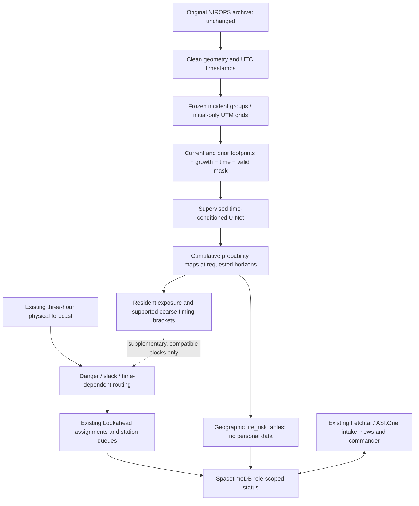

# Supervised wildfire forecasting architecture

The learned capability is spatial prediction from historical outcomes.
`forecast_ml` contains a time-conditioned PyTorch U-Net, its dataset/trainer/native
loader, common baselines and frozen evaluation. Lookahead remains the dispatcher;
the shared simulator, routing, Fetch.ai and SpacetimeDB application are preserved.

## Model and features

Width16/depth3 U-Net has482,753 parameters, three downsampling/upsampling stages
and spatial skip connections. Eight128×128 channels hold current footprint,
previous footprint, observed growth, valid mask, normalized forecast horizon,
normalized previous gap, normalized meters-per-cell and history availability.
Missing history has zero prior/growth channels and an explicit indicator.
Training and inference call the same `known_features` function.

The head predicts new-growth logits. Cumulative output retains current affected
cells. Loss is train-weighted BCE plus fixed0.2soft Dice on `valid & ~current`.
Class weight is computed from training pixels only and capped at50. Inference
subtracts `log(pos_weight)` before sigmoid to correct the BCE prior tilt. This
is approximate with Dice, so calibration is measured. Multiple horizons receive
an explicit cumulative-max projection, not a fabricated stochastic ensemble.

Gaps are actual6–72h acquisition differences, not interpolated daily truth.
Only known perimeters/timestamps and the requested horizon enter inputs. Future
polygons/weather, final bounds and resident requests never do. Historical
environmental measurements are absent; this is a perimeter-only configuration.

## Integration

`FIRE_FORECAST_BACKEND=simulation` remains the default. Learned operation needs
native weights, matching features/grid, measured validation/timing gates,
explicit configuration and compatible known history. Missing/unsupported inputs
produce visible fallback. Six-to-72h historical validation does not establish
minute-level route timing; the existing physical forecast still supplies it.

`risk.py` separates exposure, assistance duration and route-adjusted slack.
Single-horizon maps yield broad issue-to-horizon or right-censored brackets, not
precise arrival percentiles. Unknown/revised/expired products require review.
Lookahead chooses resources and queue order; the neural model does not choose
vehicles or routes.

Public `fire_risk_meta`/`fire_risk_cell` contain geographic forecasts only.
Their reducer validates role, bounds, complete monotone horizons and captured
weather/fire/clock snapshots. Private resident views, consent, commander pins
and committed missions remain. Existing `forecast_cell` is not reinterpreted
as coarse learned ETA. Physical publication also rejects stale world versions.

The October24 draft PRD originally puts learning in delegation. The explicit
user amendment makes supervised fire forecasting the learned responsibility.
Danger ownership remains Pranay; delegation/station ownership remains Sathvik.
Frontend, Claude intake and station execution gaps remain team work. Static
scheduling projections do not prove completed handoffs or realized unit release.

See [migration](ML_MIGRATION_SUMMARY.md), [features](DATA_FEATURE_SPECIFICATION.md),
[runbook](FORECAST_RUNBOOK.md), [contract](FORECAST_INFERENCE.md) and
[evaluation](FORECAST_EVALUATION.md).
