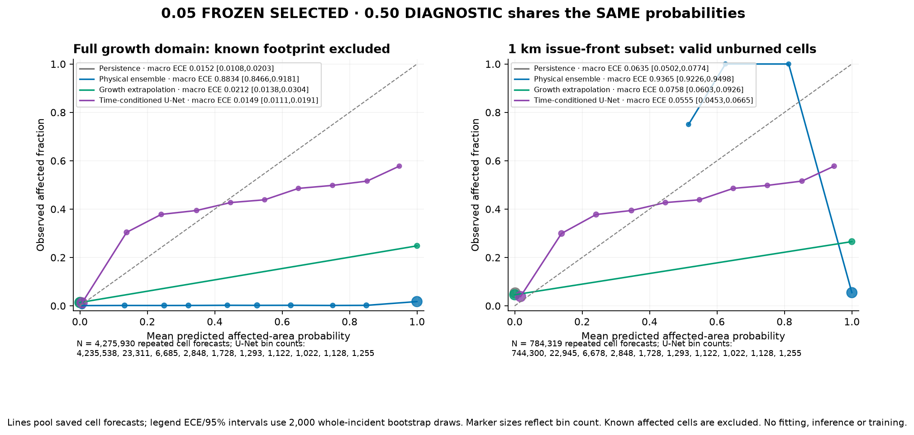
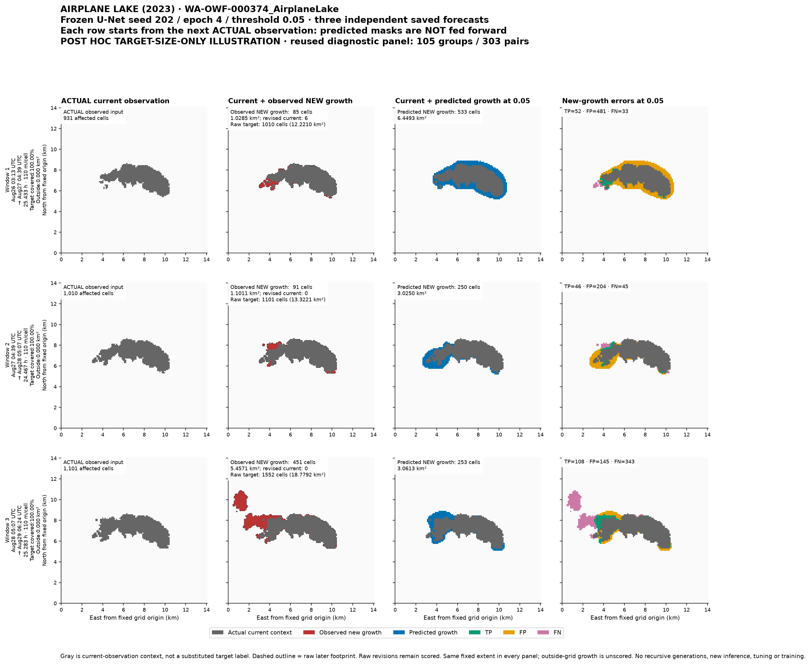
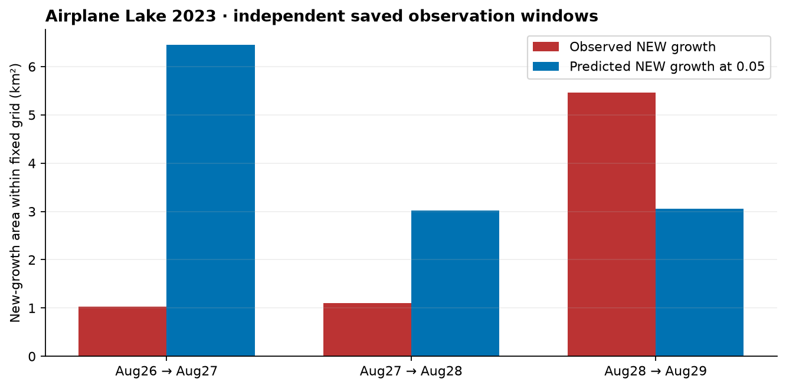

# Frozen U-Net forecast and named-fire progression

**Seed 202, epoch 4, validation-selected threshold 0.05 remain fixed.** Threshold 0.50 is diagnostic. No additional training, model selection, calibration fitting, threshold search, split changes or historical model inference occurred for these reports: they use the already saved one-pass predictions.

**The 105 incident groups / 303 forecast pairs were previously inspected.** They were held out from supervised fitting, but cannot now be called untouched confirmation data. No new split is invented. A fresh independent cohort would be required for that stronger claim.

## Selected operating point: 0.05

Values are incident macros: average defined pair metrics within each incident, then average incidents. Brackets are 95% percentile intervals from 2,000 whole-incident bootstrap draws. Known affected cells are excluded from every growth metric.

| Method | Growth IoU, all defined | Growth-positive IoU | Precision | Recall | F1 |
|---|---:|---:|---:|---:|---:|
| Persistence | 0.0000 [0.0000, 0.0000] | 0.0000 [0.0000, 0.0000] | undefined | 0.0000 [0.0000, 0.0000] | 0.0000 [0.0000, 0.0000] |
| Physics ensemble | 0.0170 [0.0121, 0.0224] | 0.0304 [0.0199, 0.0430] | 0.0171 [0.0122, 0.0226] | 0.9981 [0.9945, 1.0000] | 0.0299 [0.0219, 0.0386] |
| Growth extrapolation | 0.0178 [0.0099, 0.0270] | 0.0186 [0.0103, 0.0280] | 0.2341 [0.1517, 0.3272] | 0.0580 [0.0354, 0.0845] | 0.0282 [0.0159, 0.0420] |
| U-Net (202 / epoch 4) | 0.1061 [0.0904, 0.1227] | 0.1508 [0.1314, 0.1716] | 0.1604 [0.1364, 0.1848] | 0.5640 [0.5170, 0.6123] | 0.1676 [0.1446, 0.1917] |

| Method | ROC-AUC | Average precision | Brier | 10-bin ECE |
|---|---:|---:|---:|---:|
| Persistence | 0.5000 [0.5000, 0.5000] | 0.0269 [0.0180, 0.0378] | 0.0152 [0.0108, 0.0203] | 0.0152 [0.0108, 0.0203] |
| Physics ensemble | 0.5555 [0.5353, 0.5760] | 0.0324 [0.0214, 0.0456] | 0.8756 [0.8377, 0.9115] | 0.8834 [0.8466, 0.9181] |
| Growth extrapolation | 0.5255 [0.5152, 0.5374] | 0.0385 [0.0270, 0.0517] | 0.0212 [0.0138, 0.0304] | 0.0212 [0.0138, 0.0304] |
| U-Net (202 / epoch 4) | 0.9622 [0.9522, 0.9719] | 0.3065 [0.2701, 0.3443] | 0.0136 [0.0096, 0.0181] | 0.0149 [0.0111, 0.0191] |

All-defined IoU/F1 include false alarms on no-observed-growth pairs as zero; both-empty pairs are undefined. The narrower growth-positive IoU is retained explicitly to match the earlier benchmark and validation selection metric. Precision and one-class AUC/AP can also be undefined. All counts are retained in [metrics.json](metrics.json). High retained-footprint scores are not substituted for spread prediction.

Matched predictions from persistence, the existing 16-member physics simulator and growth extrapolation use identical cases, targets, valid masks and horizons. The physics baseline has no measured historical wind and uses the preserved synthetic-fuel configuration; its long historical horizons do not validate its original short demonstration use. Forecasting PPO was removed at the user's request, and compatible saved predictions are unavailable, so no incompatible score is compared.

The [complete metric tables](metrics.md) give paired U-Net-minus-baseline intervals for every requested metric. Paired comparisons intersect metric-specific defined **pairs before incident averaging**. Their population can differ from each model's own all-defined macro above; paired pair/group counts are shown. Persistence precision is undefined because it never predicts new growth.

## Fixed fire-front region and calibration

The region was fixed before its metric calculation: valid currently unburned cell centers within **1,000 meters of the current issue-time affected footprint**. Future geometry does not select eligibility. This is raster-center distance, not an exact polygon boundary. One of the 303 fronts is empty; no coarse cell is forced into the region.

| Region | Growth prevalence | U-Net Brier | Persistence Brier | Paired Brier difference [95% CI] |
|---|---:|---:|---:|---:|
| Full growth domain | 0.0152 [0.0108, 0.0203] | 0.0136 [0.0096, 0.0181] | 0.0152 [0.0108, 0.0203] | -0.0016 [-0.0026, -0.0008] |
| Predefined 1 km issue-front | 0.0635 [0.0502, 0.0774] | 0.0545 [0.0442, 0.0656] | 0.0635 [0.0502, 0.0774] | -0.0090 [-0.0128, -0.0058] |

Full-domain growth and full-footprint results are preserved; the existing [full-footprint benchmark](../metrics.json) was not overwritten. Pooled cell-forecast prevalence is 1.57% for full growth and 5.47% for the front, compared with the incident macros above. Pixels and repeated cell forecasts are not independent fires.

The plot pools fixed ten-bin sufficient statistics; its legend reports incident-macro ECE intervals. Better Brier does not establish operationally reliable probabilities. In particular, full-growth ECE improvement over persistence is not established by its paired interval, which crosses zero. There was no post-test recalibration.

## Fixed 0.50 diagnostic

| U-Net threshold | Precision | Recall | F1 | All-defined growth IoU | Growth-positive IoU |
|---|---:|---:|---:|---:|---:|
| 0.05 — frozen selected | 0.1604 [0.1364, 0.1848] | 0.5640 [0.5170, 0.6123] | 0.1676 [0.1446, 0.1917] | 0.1061 [0.0904, 0.1227] | 0.1508 [0.1314, 0.1716] |
| 0.50 — diagnostic | 0.4325 [0.3581, 0.5126] | 0.0492 [0.0334, 0.0668] | 0.0516 [0.0378, 0.0665] | 0.0311 [0.0222, 0.0408] | 0.0323 [0.0231, 0.0418] |

ROC-AUC, AP, Brier and calibration use probability scores and are unchanged by the diagnostic threshold. At 0.05, U-Net's full-growth pooled counts are 24,357 correct growth cells, 66,250 false alarms and 42,635 missed cells. At 0.50, only 2,928 growth cells are caught and 64,064 are missed. These are repeated cell-forecast counts, not land-area totals across independent fires.

## Airplane Lake fire: three observed generations

The named example is **AIRPLANE LAKE (2023), source WA-OWF-000374**. Four actual observations support three consecutive saved forecasts from August 26–29 UTC, on one unchanged 128×128 UTM grid at 110 meters/cell. Each row starts from its own actual current observation; predictions are not fed back as observations.

The illustration was selected post hoc using **target size only**, before viewing model quality: among eleven sequences with three saved pairs and at least ten observed growth cells in each, choose the median total observed growth (627 cells). This visibility rule does not change any metric, threshold or model selection, and the example is not a representative statistical sample.

Green marks correctly predicted new growth, amber marks false-positive growth and magenta marks missed growth. Gray is issue-time footprint context. Raw observed-footprint revisions are recorded separately; six current cells retract in the first observation pair. Outside-grid target area, if any, is not silently counted as correctly predicted.

| Forecast window (UTC, 2023) | Actual new area km² | Predicted new area km² | Correct / false / missed cells |
|---|---:|---:|---:|
| Aug 26 → 27 | 1.0285 | 6.4493 | 52 / 481 / 33 |
| Aug 27 → 28 | 1.1011 | 3.0250 | 46 / 204 / 45 |
| Aug 28 → 29 | 5.4571 | 3.0613 | 108 / 145 / 343 |

The model overpredicts early growth and misses much of the larger third-window expansion. It has no observed historical wind, vegetation or terrain inputs, so these figures cannot demonstrate responses to those drivers or precise arrival timing. Original observations are irregular perimeter snapshots, not continuous fire-front truth.

## Evidence and reproducibility

- [Frozen weights, features, predictions and split receipt](freeze_receipt.json)
- [Region, threshold, metric and bootstrap protocol](protocol.json)
- [All macro, pooled and paired results](metrics.json)
- [All paired intervals and undefined populations](metrics.md)
- [Full pipeline, native reload, data preservation and non-training checks](../verification.json)
- [PRD traceability and unresolved integration work](../../../docs/PRD_IMPLEMENTATION_AUDIT.md)

Raw predictions, per-pair/per-incident JSON and native weights remain local and preserved, with hashes in these receipts; large files are gitignored. Rebuilds consume saved predictions only. Main and production settings remain unchanged; the application's default stays simulation and Lookahead. Historical classification and this illustration do not validate completed rescue handoffs.
